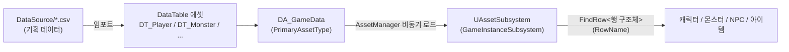

# 🌳 Elm Chronicles (엘름 연대기)

> **Unreal Engine 5 · C++ 로 만든 싱글플레이 액션 RPG 포트폴리오**
> 데이터 주도 설계, Gameplay Ability System(GAS), AI(Perception + Behavior Tree)를 직접 설계하고 구현했습니다.


## ▶ 플레이 영상

[](https://youtu.be/ObFnJUawyBg)

> 이미지를 누르면 YouTube로 이동합니다. (https://youtu.be/ObFnJUawyBg)

---

## 📌 한눈에 보기 (30초 요약)

| 항목 | 내용 |
| --- | --- |
| 장르 | 싱글플레이 3D 액션 RPG (참고: 젤다 야숨, 위쳐3, 엘더스크롤5) |
| 배경 | 동화 같은 중세 숲 왕국 "엘름" — 은퇴한 왕실 기사 카일의 이야기 |
| 엔진 / 언어 | Unreal Engine 5.8 / C++ (Blueprint는 애니메이션·UI 레이아웃·몬스터 투사체 등 에셋 영역에 한정) |
| 개발 기간 | 4주 (2026.10.08 ~ 11.04) |
| 개발 인원 | 1인 개발 (기획·클라이언트 프로그래밍·레벨 구성) |
| 코드 규모 | C++ 131개 파일 / 약 7,300줄 (`Source/`) |
| 핵심 기술 | AssetManager · DataTable/DataAsset · GAS · AIPerception + Behavior Tree · Enhanced Input · UMG |
| 콘텐츠 | 맵 9개(필드, 동굴, 왕궁, 상점, 선술집, 병원 등), 근접/원거리/마법 몬스터, NPC, 인벤토리·장비 |

---

## 🎯 이 프로젝트에서 보여드리고 싶은 역량

1. **확장 가능한 구조를 설계하는 능력**
   캐릭터·몬스터·NPC·아이템을 모두 DataTable 한 줄(Row) 로 정의합니다. 몬스터를 추가할 때 C++ 수정 없이 CSV 행만 추가하면 됩니다.
2. **GAS(Gameplay Ability System)를 실전 구조로 쓰는 능력**
   플레이어·몬스터·NPC가 같은 공격 어빌리티를 공유하고, 데미지는 Execution Calculation 파이프라인 한 곳에서만 처리합니다.
3. **엔진 내부 동작을 파고들어 문제를 해결하는 능력**
   레벨 이동 시 화면 번쩍임, 애니메이션 노티파이 중복 판정 등을 원인까지 추적해 해결하고 기록으로 남겼습니다.

---

## 🎮 게임 소개

> 오늘은 자랑스러운 엘름 왕국의 왕실 기사직을 내려놓고 은퇴하는 날이다.
> 퇴역 군인 카일은 왕에게 작별 인사를 건네고, 상점에서 장비를 갖추고, 선술집에서 의뢰를 받아 왕국을 위협하는 존재와 맞서게 된다.

- 마을(왕궁·상점·선술집·병원)과 바깥 필드/던전을 포탈로 오가며 전투와 성장을 반복하는 구조
- 몬스터 등급(노멀 / 에픽 / 보스)에 따라 크기·체력·보상이 달라지는 전투
- 사망 시 마을 병원에서 다시 시작 (구현 예정)

전체 기획(세계관, 능력치·데미지 공식, 몬스터 등급, 아이템, 퀘스트 5종, 주차별 일정)은 [`Docs/Plan.md`](Docs/Plan.md)에 있습니다.

### 조작 (현재 구현분)

| 기능 | 입력 |
| --- | --- |
| 이동 / 점프 | `WASD` / `Space` |
| 공격 (콤보) | 마우스 왼쪽 버튼 |
| 상호작용 (NPC, 포탈) | `E` |
| 인벤토리 | `I` (아이템 드래그 앤 드롭 정렬, 우클릭으로 사용/장착) |

---

## ✅ 구현 현황

| 영역 | 상태 | 내용 |
| --- | :---: | --- |
| 데이터 로딩 | ✅ | AssetManager + `UAssetSubsystem` 비동기 로딩, DataTable 6종 (Player / Monster / NPC / Item / LevelStat / Dialogue) |
| 플레이어 | ✅ | Enhanced Input 이동·점프, 3단 콤보 공격, 스탯 테이블 기반 초기화 |
| 전투 (GAS) | ✅ | 근접(Sweep) / 원거리(투사체) 어빌리티, 몽타주 노티파이 기반 타격 판정, MP·쿨다운 비용, 데미지 Execution |
| 몬스터 AI | ✅ | AIPerception 시야 + Behavior Tree, 순찰·추적·공격, 노멀/에픽/보스 등급 배율 |
| NPC | ✅ | 필수 NPC는 쓰러져도 일정 시간 뒤 부활, 상호작용 인터페이스(`IInteractable`) |
| 스포너 | ✅ | `AAISpawner` 하나로 몬스터/NPC 스폰, 1회/반복 재생성, 에디터에서 DT 행 선택 콤보박스 |
| 인벤토리·장비 | ✅ | 슬롯 인벤토리, 드래그 앤 드롭 정렬, 포션 사용, 무기·방어구 장착 |
| HUD | ✅ | HP/MP 바(Attribute 델리게이트 구독), 상호작용 안내 문구 |
| 레벨 이동 | ✅ | 포탈 → 페이드 → 맵 전환, 가방·능력치 유지, 도착 지점 태그 지정 |
| NPC 대화 | 🔧 | 대화 데이터(`DT_Dialogue`)·대화창 위젯 작업 중 (설계: [`NPCDialogue_Plan.md`](Docs/NPCDialogue_Plan.md)) |
| 사망 → 병원 부활 | 🔧 | 설계 단계 |
| 퀘스트 / 상점 / 스킬 1~4 / 자동 레벨업 | 📋 | 기획 완료, 구현 예정 |
| 툰 셰이딩·외곽선 | 📋 | 계획 문서 작성 ([`StylizedRendering.md`](Docs/StylizedRendering.md)) |

> ✅ 구현 완료 · 🔧 진행 중 · 📋 예정 — 4주 일정 안에서 전투·AI·데이터 구조의 **완성도**를 우선하고, 콘텐츠 확장은 구조 위에 얹도록 설계했습니다.

---

## 🧱 기술 하이라이트

### 1. 데이터 주도 설계 (AssetManager → DataTable)



- 테이블을 행 구조체 이름으로 등록해, 새 테이블은 구조체 정의 + `DA_GameData`에 추가만 하면 코드 수정 없이 조회됩니다.
- 비동기 로딩 타이밍 문제를 `CallOrRegisterDataLoaded`로 일관되게 처리 (BeginPlay 시점에 테이블이 없어도 안전).
- 에디터 Details 패널의 행 선택 콤보박스는 서브시스템이 없는 시점에도 동작하도록 `GetRowNamesInEditor`(static)로 별도 구현.
- 기획 수치(`Docs/Plan.md`) → CSV → DataTable 흐름을 스크립트(`dt-csv-sync`)로 자동 검사·동기화.

### 2. 캐릭터 계층과 GAS 구성

```
AElmCharacterBase (Abstract)   팀, 장비 메시, 외형 적용, 공격 몽타주, 피격/사망 처리
├─ APlayerCharacter            ASC 소유자 = PlayerState (캐릭터가 바뀌어도 능력 유지)
└─ AAICharacter (Abstract)     ASC 소유자 = 자기 자신, 데이터 행으로 외형/능력치/공격 결정
   ├─ AMonsterCharacter        등급 배율(Epic/Boss), 처치 보상
   └─ ANPCCharacter            상호작용, 필수 NPC 부활
```

- **AttributeSet 계층 = 테이블 행 계층 (1:1)**: `Base → Player / AI → Monster / NPC`. 서브클래스 생성자에서 `SetDefaultSubobjectClass`로 AttributeSet을 교체해 부모 코드를 건드리지 않고 확장.
- **공격 어빌리티 공유**: 플레이어·몬스터·NPC가 같은 `UGameplayAbility_Attack`을 쓰고, 자식(`Melee`/`Ranged`)은 `OnAttackHit`만 구현.
- **콤보**: 몽타주 섹션이 여러 개면 콤보. `ComboOpen`~`ComboClose` 노티파이 구간에서만 다음 입력을 받음.
- **데미지 파이프라인 단일화**: `MakeDamageSpec → GE_Damage → UElmDamageExecution → IncomingDamage(Meta Attribute) → PostGameplayEffectExecute`. 공격력은 스펙 생성 시점 스냅샷, 방어력은 적용 시점 값을 사용하고 HP를 직접 깎지 않습니다. (`데미지 = 공격력 × 100 / (100 + 방어력)`, 최소 1)
- GameplayTag는 C++ 네이티브 태그(`ElmTags::`)로만 관리, GameplayEffect는 에셋이 아닌 C++ 클래스 + SetByCaller로 수치 주입.

### 3. AI와 팀 시스템

- AIPerception(시야) + `BT_Monster` / `BB_Monster`. 몬스터와 NPC가 같은 Behavior Tree를 공유.
- **아군/적 구분을 충돌 채널이 아닌 "팀 관계표"(`SolveTeamAttitude`)로 처리**: AI 시야와 공격 판정이 같은 규칙을 거치므로 팀이 늘어도 채널을 늘릴 필요가 없습니다.
- Service(`CheckAttackRange`, 0.1초 주기)로 타겟 선택과 공격 사거리 판정, Task(`MonsterAttack`)로 어빌리티 실행·취소.

### 4. 레벨 이동과 상태 유지

`OpenLevel`은 World / Controller / PlayerState / Pawn을 모두 파괴하므로, GameInstance에 살아남는 `USaveSubsystem`이 이동 직전 상태를 "메모(`UElmSaveGame`)"로 기록하고 새 레벨의 컴포넌트가 초기화 시점에 읽어 복원합니다.

- URL의 `#태그`로 도착 `PlayerStart`를 지정 (엔진 기본 흐름을 활용해 추가 코드 없음)
- 페이드 아웃 → 로딩 → 검정 유지 → 페이드 인, 입력 차단 + 중복 이동 방지 플래그
- 저장 대상은 Base 값(`GetNumericAttributeBase`)만 사용해 장비 버프가 섞이지 않도록 처리
- 디스크 세이브(`SaveGameToSlot`)로 그대로 확장 가능한 구조

---

## 🔍 문제 해결 사례

| 문제 | 원인 분석 | 해결 |
| --- | --- | --- |
| 한 번의 공격에 타격 판정이 두 번 발생 | 노티파이를 애니메이션 시퀀스에 넣었더니, 같은 시퀀스를 쓰는 다른 몽타주에서도 함께 울림 | 판정용 노티파이는 몽타주에만 배치하는 규칙으로 정립 |
| 모자·투구·망토가 엉뚱한 위치에 붙음 | 장비 메시의 피벗이 캐릭터 원점이라 소켓에 그대로 붙이면 어긋남 | 본 레퍼런스 포즈의 역행렬로 보정하는 `AttachBindPoseGear` 구현 |
| 레벨 이동 직후 페이드 인이 한 프레임에 끝나 화면이 번쩍임 | 로딩 직후 프레임의 DeltaTime에 로딩 시간(0.25~0.59초)이 한꺼번에 반영 | 도착 시 검은 화면을 일정 시간 유지한 뒤 페이드 인하도록 변경 |
| 에디터 시점에서 DataTable RowName 가져오기 | 에디터 시점에는 GameInstanceSubsystem이 존재하지 않음 | AssetManager에서 `DA_GameData`를 동기 로드하는 static 조회 함수 추가 |

---

## 🗂 프로젝트 구조

```
ElmChronicles/
├─ Source/ElmChronicles/
│  ├─ AbilitySystem/   GAS: Abilities, Attributes, Effects, Components, GameplayTags
│  ├─ AI/              AIController, BTTask / BTService, 팀 관계표
│  ├─ Characters/      Base / Player / AI / Monster / NPC, Spawners, Projectiles
│  ├─ Data/            GameDataAsset, Tables/ (DataTable 행 구조체)
│  ├─ Subsystem/       AssetSubsystem(데이터 로딩), SaveSubsystem(레벨 이동·상태 유지)
│  ├─ Player/          PlayerController / PlayerState / InventoryComponent
│  ├─ Interaction/     IInteractable, LevelPortal
│  ├─ Item/            ItemObject, ItemBox
│  ├─ UI/Game/         HUD, 인벤토리, 아이템 정보, 대화창 위젯
│  ├─ Animations/      AnimInstance, 몽타주 → GameplayEvent 노티파이
│  └─ Input/           Enhanced Input 설정
├─ Content/            맵, 데이터 에셋, 애니메이션, 입력 에셋, UI 블루프린트
├─ DataSource/         DataTable 원본 CSV
├─ Config/             엔진·입력·GameplayTag 설정
└─ Docs/               기획서(Plan.md), 작업 계획·진행 문서
```

### 함께 보시면 좋은 파일

| 보고 싶은 것 | 파일 |
| --- | --- |
| 데이터 로딩 구조 | `Subsystem/AssetSubsystem.cpp`, `Data/GameDataAsset.h` |
| GAS 어빌리티 베이스 / 공격 | `AbilitySystem/Abilities/ElmGameplayAbility.cpp`, `GameplayAbility_Attack.cpp` |
| 데미지 계산 | `AbilitySystem/Effects/ElmDamageExecution.cpp` |
| 캐릭터 초기화 흐름 | `Characters/ElmCharacterBase.cpp`, `AICharacter.cpp` |
| 몬스터 AI | `AI/ElmAIController.cpp`, `AI/BTService/`, `AI/BTTask/` |
| 레벨 이동 | `Subsystem/SaveSubsystem.cpp`, `Interaction/LevelPortal.cpp` |
| 인벤토리 | `Player/InventoryComponent.cpp`, `UI/Game/InventoryWidget.cpp` |

---

## 🛠 실행 방법

**요구 사항**: Windows, Unreal Engine 5.8, Visual Studio (C++ 게임 개발 워크로드)

1. 저장소를 클론합니다.
2. `ElmChronicles.uproject` 우클릭 → **Generate Visual Studio project files**
3. 솔루션에서 `ElmChroniclesEditor` / `Win64` / `Development Editor`로 빌드하거나, `.uproject`를 더블 클릭해 에디터를 실행합니다.
4. 시작 맵은 `/Game/Maps/Test`입니다. 필드·동굴 등 월드 맵은 `Content/Maps/ElmKingdom/`에 있고, Field ↔ OrcCave 포탈로 레벨 이동을 확인할 수 있습니다.

> 에디터 실행 중 IDE 빌드는 Hot Reload 크래시 위험이 있으니, 헤더를 바꿨다면 에디터를 끄고 빌드해 주세요.

---

## 🤝 개발 방식 및 AI 도구 활용

- 구현은 직접 하고, AI 코딩 도구(Claude Code)는 **단계별 설계 안내와 코드 리뷰** 용도로 활용했습니다. 단계마다 "계획 → 직접 구현·빌드·PIE 테스트 → 리뷰 → 문서 갱신" 루프를 돌았고, 그 기록이 `Docs/*_Plan.md` / `*_Progress.md`에 남아 있습니다.
- AI에게 맥락을 일관되게 전달하기 위해 아키텍처 규칙·코드 컨벤션·빌드 주의사항을 [`CLAUDE.md`](CLAUDE.md)에 정리했습니다. 이 문서는 사람이 읽는 **아키텍처 설명서**로도 쓸 수 있습니다.
- 코드 컨벤션: 멤버 변수 `m` 접두사, `bool`은 `Is` 접두사, 주석은 "왜 이렇게 하는지"를 한글로 기록.

---

## 🎨 사용 에셋

- 캐릭터·무기·던전·자연물·애니메이션·아이콘: [KayKit](https://kaylousberg.itch.io/) 무료 에셋 팩
- UI·이모트: [Kenney](https://kenney.nl/) 에셋
- 각 에셋의 라이선스는 제공처의 조건을 따릅니다. 코드와 기획·데이터는 직접 작성했습니다.

---

## 📬 Contact

| | |
| --- | --- |
| 이름 | 임대호 |
| 이메일 | silco424@gmail.com |
| GitHub | [@silco-zaun](https://github.com/silco-zaun) |
